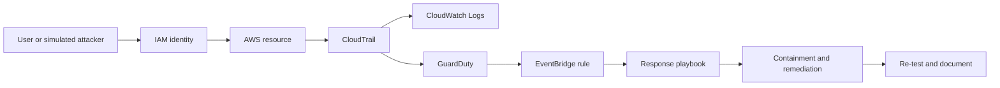

# Cloud Security Analyst Career and Portfolio Plan

## Assumptions

- Target: AWS Cloud Security Analyst / Junior Cloud Security Engineer
- Market: India, remote-friendly product companies, MSSPs, consulting, and banks
- Timeline: six months
- Background: third-year B.Tech CSE Core student at VIT Chennai
- Experience: fresher unless an internship is verified in the resume
- Study time: 10 hours/week
- Certifications: none assumed; replace with verified certifications only

## Positioning

### Portfolio headline

**Aspiring AWS Cloud Security Analyst building detection, IAM, and DevSecOps labs.**

### Value statement

I build and document hands-on AWS security labs that turn cloud telemetry into actionable detections, reduce misconfiguration risk, and automate security checks in delivery pipelines.

### Short bio

I’m a third-year Computer Science student at VIT Chennai preparing for cloud security analyst roles. I’m building practical AWS security projects around IAM, CloudTrail, GuardDuty, infrastructure as code, incident response, and secure CI/CD. My goal is to become useful quickly in a security team by combining systems fundamentals, automation, and clear technical reporting.

### Long bio

I’m a third-year B.Tech Computer Science student at VIT Chennai focused on cloud security and software engineering. I learn best by building complete security workflows: defining a threat model, deploying a controlled lab, collecting telemetry, writing detections, testing an attack path, remediating the issue, and documenting the evidence. My current focus is AWS identity security, logging and detection, Terraform guardrails, DevSecOps scanning, and incident response. I’m seeking an entry-level Cloud Security Analyst, Cloud Security Engineer, or Security Operations role where I can contribute to monitoring, investigation, hardening, and automation.

## Portfolio audit

| Area | Score | Recruiter view |
|---|---:|---|
| First impression | 7/10 | Strong visual identity and clear software-building ability; cloud security is not yet the first message. |
| Cloud-security signaling | 4/10 | AWS security services, detections, IAM, incident response, and compliance evidence need to become the primary project story. |
| Content quality | 6/10 | Good project breadth; some claims need links, screenshots, benchmarks, and reproducible steps. |
| Project depth | 6/10 | Dual-enjoy and platform projects show engineering range; security projects need attack paths, findings, remediation, and mappings. |
| Design | 8/10 | Polished and distinctive; reduce decorative motion when it competes with security evidence. |
| Mobile responsiveness | 7/10 | Responsive component structure exists; verify modal, diagram, navigation, and evidence cards at 375px. |
| Performance | 6/10 | Production build works, but the main JavaScript bundle is large; defer particles and GitHub widgets. |
| Accessibility | 7/10 | Labels, focus work, reduced-motion support, and accessible navigation exist; run axe/Lighthouse and fix remaining findings. |
| SEO | 8/10 | Canonical URL, Open Graph, sitemap, robots, and structured data exist; add security-focused project metadata. |
| Security hygiene | 7/10 | No public secret should be committed; add CSP, dependency audit, security policy, and explicit environment-variable guidance. |

## Top gaps in priority order

1. Cloud security is not the hero message. A recruiter should see AWS security within six seconds.
2. There are not yet three public, reproducible AWS security case studies.
3. Security claims need evidence: findings, screenshots, logs, detection rules, remediation diffs, and mappings.
4. The portfolio needs a dedicated Labs section with attack, detection, and remediation workflows.
5. Add a real CI security pipeline with secret scanning, SAST, IaC scanning, and container scanning.
6. Add a professional finding report template with severity, affected resource, evidence, impact, remediation, and verification.
7. Add AWS cost controls and cleanup instructions to every lab.
8. Make certifications honest: show “planned” or “in progress” until earned.
9. Replace broad skill lists with skills linked to projects and evidence.
10. Reduce bundle cost and verify Lighthouse performance on a mobile profile.

## Skills matrix

### Cloud platforms

AWS IAM, Organizations, CloudTrail, GuardDuty, Security Hub, Config, S3 security, VPC security groups, KMS, CloudWatch, Lambda, EC2, EventBridge. Mark each as `learning`, `lab-tested`, or `verified in work`.

### Detection and response

CloudTrail investigation, GuardDuty finding triage, CloudWatch Logs and alarms, EventBridge response, credential compromise investigation, containment, eradication, recovery, and post-incident reporting.

### IaC and DevSecOps

Terraform, GitHub Actions, Checkov, tfsec or Trivy IaC scanning, Gitleaks, Semgrep, dependency scanning, container image scanning, branch protection, and artifact handling.

### Frameworks and compliance

Shared Responsibility Model, CIS AWS Foundations Benchmark, NIST CSF, MITRE ATT&CK, ISO 27001 concepts, least privilege, defense in depth, and risk-based prioritization.

### Tools

Linux, Git, GitHub, Docker, Wireshark, jq, AWS CLI, Terraform CLI, Python, Bash, Markdown, Mermaid, and a SIEM or log analytics platform used in a documented lab.

### Scripting

Python and Bash for AWS inventory, IAM analysis, log parsing, alert enrichment, evidence collection, and cleanup automation.

## Five portfolio-grade projects

### 1. AWS security baseline checker — easiest

Objective: inventory an AWS account and report risky IAM, S3, CloudTrail, and security-group configurations.

Build: create read-only IAM permissions; write Python checks; emit JSON and Markdown; map findings to CIS controls; add unit tests; run it against a deliberately misconfigured local fixture or controlled sandbox.

Evidence: sample report, severity table, unit-test output, remediation examples, and a screenshot of the generated report.

Time: 1–2 weeks. Cost: zero with local fixtures; AWS API calls should remain within free usage. Never scan accounts you do not own.

### 2. Vulnerable AWS lab audit

Objective: deploy a controlled vulnerable lab, identify misconfigurations, and produce a professional audit report.

Build: use a known training lab such as CloudGoat only in an isolated personal account; document scope and cleanup; enumerate attack paths; capture evidence; remediate; rerun checks.

Evidence: architecture diagram, attack-path diagram, finding report, before/after configuration, and cleanup log.

Time: 2 weeks. Cost: possible AWS charges for compute, logs, NAT, or forgotten resources. Set billing alerts and destroy resources after each session.

### 3. AWS threat detection pipeline

Objective: detect suspicious IAM and network activity using CloudTrail, GuardDuty, CloudWatch, EventBridge, and a searchable log destination.

Build: enable regional logging; create realistic test events; write detection rules; map them to MITRE ATT&CK; route high-confidence findings to an alert channel; document false positives.

Evidence: log event, detection rule, alert, triage notes, MITRE mapping, and response playbook.

Time: 3–4 weeks. Cost: CloudTrail, GuardDuty, and log ingestion may incur charges; use a dedicated sandbox and delete data stores after testing.

### 4. Secure DevSecOps pipeline

Objective: fail a pull request when code, secrets, dependencies, Terraform, or containers violate defined security gates.

Build: GitHub Actions workflow with Gitleaks, Semgrep, npm audit or pip-audit, Checkov, Trivy, test, build, and artifact steps; define severity thresholds; document exceptions.

Evidence: passing workflow, intentionally failing pull request, security report, and policy explanation.

Time: 2–3 weeks. Cost: free for public GitHub repositories within usage limits.

### 5. Compromised IAM credential incident response — hardest

Objective: simulate access-key exposure, detect activity, contain the credential, determine scope, and write a post-incident report.

Build: use a disposable account and synthetic credential; generate controlled API events; investigate CloudTrail; disable or rotate keys; check persistence and privilege changes; record a timeline; perform recovery and lessons learned.

Evidence: timeline, query commands, finding screenshots, containment checklist, root-cause analysis, and post-incident report.

Time: 3–4 weeks. Cost: low but non-zero for logging and services. Never use a real credential or real production account.

## Case-study format

Use this structure for every security lab:

1. Problem and scope
2. Threat model and assumptions
3. Architecture diagram
4. Tools and versions
5. Steps performed
6. Findings and detections
7. Evidence
8. Remediation
9. CIS or MITRE ATT&CK mapping
10. Verification after remediation
11. Cost and cleanup notes
12. Outcome
13. Lessons learned
14. GitHub link and reproducibility instructions

### Mermaid template

## Six-month roadmap

### Month 1: foundations

Weeks 1–2: TCP/IP, DNS, HTTP, TLS, Linux permissions, processes, logs, Git, Python basics, AWS account safety, IAM users/roles/policies, and the Shared Responsibility Model.

Weeks 3–4: S3 policies, security groups, CloudTrail, CloudWatch, KMS basics, AWS CLI, and the security baseline checker.

Milestone: one working audit tool, one report, one architecture diagram, and a public README.

### Month 2: AWS security services

Weeks 5–6: GuardDuty, Security Hub, Config, EventBridge, VPC flow logs, and least privilege.

Weeks 7–8: build the threat detection pipeline and document one complete finding from event to remediation.

Milestone: one detection lab with screenshots, logs, playbook, and MITRE/CIS mapping.

### Month 3: infrastructure and DevSecOps

Weeks 9–10: Terraform modules, state security, IAM for CI, secret handling, and Checkov.

Weeks 11–12: GitHub Actions with Gitleaks, Semgrep, dependency scanning, Trivy, tests, and policy gates.

Milestone: one intentionally failing PR and one passing secure pipeline.

### Month 4: incident response

Weeks 13–14: incident lifecycle, triage, timelines, evidence preservation, and credential compromise.

Weeks 15–16: complete the simulated IAM incident; write the post-incident report and recovery checklist.

Milestone: public incident report with sanitized evidence and verified cleanup.

### Month 5: certification and interview preparation

Weeks 17–18: Security+ or AWS Cloud Practitioner fundamentals, depending on baseline; study IAM, networking, logging, and risk.

Weeks 19–20: AWS Security Specialty topics at an introductory level; practice scenario questions and explain each lab aloud.

Milestone: resume, GitHub profile, portfolio labs, and three short project walkthroughs ready.

### Month 6: applications and iteration

Weeks 21–22: apply to 5–8 targeted roles per week; contact alumni and practitioners; request feedback.

Weeks 23–24: mock interviews, improve weak labs, publish one technical write-up, and track applications.

Milestone: 40–60 targeted applications, 20 networking conversations, and a portfolio with three complete security case studies.

## Certification order

1. Optional: AWS Cloud Practitioner if you need a structured AWS baseline.
2. Security+ if you need broad security fundamentals and the job market values it.
3. AWS Certified Security – Specialty after real AWS labs and stronger AWS fundamentals.
4. Consider AZ-900/SC-900 only if target job descriptions are Azure-heavy.
5. Do not list a certification as earned until the exam is passed.

Use official AWS Skill Builder material, AWS documentation, AWS Well-Architected Security Pillar, MITRE ATT&CK, NIST CSF, CIS Benchmarks, and reputable practice questions. Confirm current exam objectives and prices before booking.

## ATS resume draft

**Gokul Ramachandran**

Third-year B.Tech Computer Science student at VIT Chennai targeting AWS Cloud Security Analyst and Junior Cloud Security Engineer roles.

**Summary**

Computer Science student building hands-on AWS security labs across IAM, CloudTrail, GuardDuty, Terraform, DevSecOps, and incident response. Combines software engineering skills in TypeScript, React, Node.js, Python, and C# with a focus on automation, detection, secure configuration, and clear technical reporting.

**Skills**

AWS IAM, CloudTrail, GuardDuty, Security Hub, CloudWatch, S3 security, Terraform, GitHub Actions, Checkov, Gitleaks, Semgrep, Trivy, Linux, Python, Bash, TypeScript, Node.js, Git, Docker, MITRE ATT&CK, CIS Benchmarks, NIST CSF.

**Projects**

- Built an AWS security baseline checker with Python to identify IAM, S3, logging, and network misconfigurations; add measured scan coverage after testing. [VERIFY]
- Built a CloudTrail and GuardDuty detection lab with EventBridge response workflows; add alert latency and false-positive results after measurement. [VERIFY]
- Automated SAST, secret scanning, IaC scanning, dependency checks, and container scanning in GitHub Actions; add pipeline duration and prevented findings after measurement. [VERIFY]

**Education**

B.Tech Computer Science and Engineering, VIT Chennai — expected [VERIFY]

## LinkedIn and GitHub

### LinkedIn headline

Third-Year CSE Student at VIT Chennai | Aspiring AWS Cloud Security Analyst | IAM, Detection Engineering, DevSecOps

### LinkedIn About

I’m a third-year Computer Science student at VIT Chennai preparing for entry-level cloud security roles. I build hands-on AWS labs around IAM, CloudTrail, GuardDuty, Terraform guardrails, secure CI/CD, and incident response. I document the full workflow—from threat model and attack simulation to detection, remediation, verification, and lessons learned. I’m open to Cloud Security Analyst, Security Operations, and Junior Cloud Security Engineer opportunities in India and remote teams.

### GitHub profile README priorities

Lead with cloud-security positioning; pin three security labs; show current learning; link reports and demos; remove unsupported claims; add a clear contact CTA.

## Interview preparation

1. How does the AWS Shared Responsibility Model affect a customer? Explain provider versus customer controls with examples.
2. How would you investigate a public S3 bucket? Check policy, ACL, block-public-access settings, access logs, CloudTrail data events, exposure scope, and business owner; contain first, then remediate and verify.
3. What is the difference between an IAM user and role? Explain temporary credentials, workload identity, federation, and least privilege.
4. How would you respond to a leaked access key? Disable or revoke it, preserve evidence, identify usage in CloudTrail, inspect persistence, rotate dependencies, remediate the leak, and document the incident.
5. What does GuardDuty do? Explain managed threat detection, finding types, evidence, severity, and the need for triage rather than blind automation.
6. How do you secure Terraform state? Encrypt it, restrict access, enable versioning and locking where supported, avoid secrets in state, and separate environments.
7. What belongs in a detection rule? Signal, data source, condition, severity, owner, response, false-positive guidance, and validation test.
8. How do you prioritize vulnerabilities? Combine exploitability, exposure, privilege, asset criticality, business impact, and compensating controls.
9. What should a secure CI pipeline do? Validate code, dependencies, secrets, IaC, containers, tests, artifacts, and deployment permissions with reviewable policy.
10. What is a false positive and how do you handle it? Confirm context, document the reason, tune the rule narrowly, and monitor for regression.

### Scenario answers

- S3 exposed: restrict public access, preserve policy and access evidence, identify data exposure, notify the owner, remediate, and verify with an external access test.
- Leaked key: revoke quickly, investigate CloudTrail, check privilege changes and persistence, rotate all dependent secrets, and record a timeline.
- Suspicious GuardDuty finding: validate resource, identity, region, time, and API calls; contain proportionally; escalate if confirmed; document closure evidence.
- Open security group: identify internet-facing exposure and affected service, restrict to required sources, check historical access, and add IaC prevention.
- Malicious CI change: stop deployment, protect the branch, preserve workflow and commit evidence, rotate compromised secrets, review runner permissions, and restore from a trusted revision.

## 30-day job-search plan

Days 1–7: finish the AWS baseline lab; update GitHub README; update resume and LinkedIn; create a target-company sheet.

Days 8–14: publish the detection lab; contact 10 VIT alumni or cloud-security practitioners; apply to 5 targeted roles.

Days 15–21: publish the DevSecOps pipeline; complete 2 mock interviews; apply to 8 targeted roles.

Days 22–30: publish the incident-response report; request portfolio feedback; apply to 8–10 targeted roles; review response rates.

Search terms: `Cloud Security Analyst`, `AWS Security Analyst`, `SOC Analyst Cloud`, `Cloud Security Intern`, `Junior Cloud Security Engineer`, `Security Operations AWS`, `DevSecOps Intern`, `IAM Analyst`, `Cloud Detection Engineer Intern`.

### Outreach message

Hi [Name], I’m a third-year CSE student at VIT Chennai preparing for AWS cloud security roles. I’m building public labs around IAM, CloudTrail/GuardDuty detections, Terraform guardrails, and incident response. I noticed your work at [company/team] and would value one piece of advice on the skills your team expects from entry-level candidates. Portfolio: [link]. Thank you.

## Launch checklist

- All GitHub, LinkedIn, resume, demo, and email links work.
- Mobile checks completed at 375px, 768px, and desktop width.
- Lighthouse performance, accessibility, best practices, and SEO reviewed.
- Keyboard-only navigation and visible focus verified.
- Reduced-motion behavior verified.
- No secrets, access keys, tokens, or private data committed.
- CSP and security headers configured at the hosting layer.
- HTTPS-only custom domain configured.
- `robots.txt`, sitemap, canonical URL, Open Graph, and structured data validated.
- Contact form has rate limiting or a managed provider and no unnecessary data collection.
- Dependency audit and GitHub secret scanning enabled.
- AWS labs include budget alarms and cleanup instructions.
- Every security claim has a public evidence link or `[VERIFY]` marker before publication.

## Top 5 things to do this week

1. Change the portfolio hero and GitHub README to AWS cloud security positioning.
2. Build and publish the AWS security baseline checker.
3. Add a dedicated Security Labs section with scope, evidence, cost, and cleanup notes.
4. Create a GitHub Actions security pipeline using Gitleaks, Semgrep, Checkov, and Trivy.
5. Update your resume and LinkedIn headline, then contact 10 alumni or cloud-security professionals.
